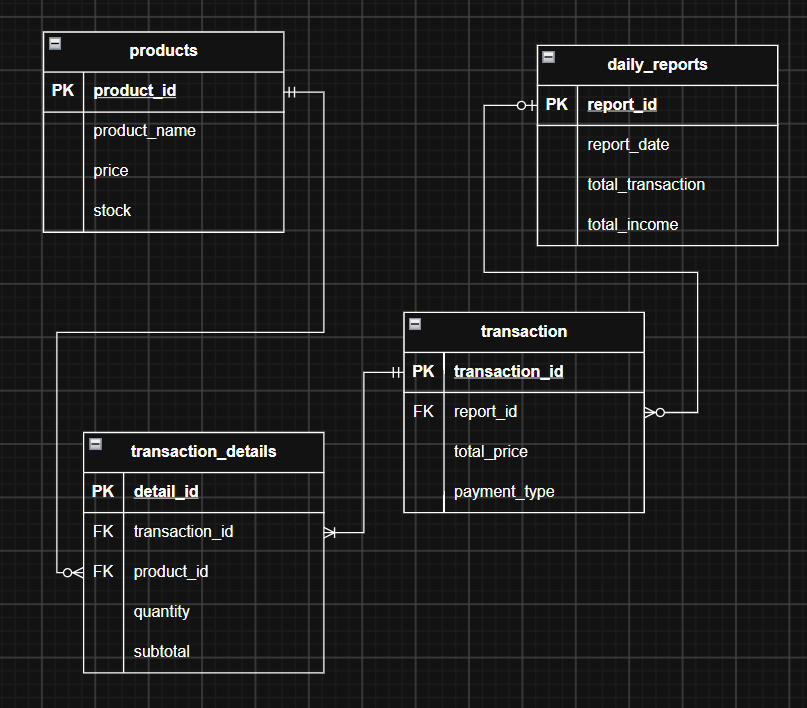

# Sistem POS Bakery Sederhana
Program Point of Sale (POS) sederhana untuk toko roti (bakery) skala kecil. Dioperasikan oleh kasir untuk mengelola inventory, memproses transaksi, dan menghasilkan laporan penjualan harian.

## Deskripsi

Program ini dirancang untuk toko roti kecil atau usaha roti rumahan yang belum menggunakan sistem POS komersial. Program dioperasikan oleh kasir dan mencakup empat fungsi utama:

1. **Pengelolaan inventory.** Menambah, mengurangi, dan mengedit data produk, serta mengatur stok.
2. **Pengelolaan keranjang (cart).** Menambah dan mengurangi produk yang dibeli pelanggan sebelum transaksi diproses.
3. **Pemrosesan transaksi.** Setiap transaksi yang selesai menghasilkan struk (receipt) berisi ID pelanggan, daftar produk yang dibeli, total harga, waktu pembelian, dan metode pembayaran.
4. **Laporan penjualan harian.** Seluruh transaksi yang selesai disimpan sebagai data penjualan. Pada akhir hari, kasir dapat menutup hari operasional dan program menampilkan total pendapatan serta jumlah transaksi.

## Tujuan

1. Membantu kasir toko roti mencatat penjualan secara cepat dan akurat, terutama pada jam ramai.
2. Menjaga agar data stok produk selalu sesuai dengan penjualan yang terjadi.
3. Menghasilkan rekap penjualan harian secara otomatis tanpa hitung manual.
4. Menerapkan konsep pemrograman yang telah dipelajari, seperti pada studi kasus usaha nyata.

## Target

- **Pengguna:** kasir dan pemilik toko roti kecil atau usaha roti rumahan.
- **Hasil:** program yang menjalankan seluruh alur kerja (inventory, keranjang, transaksi, laporan harian) tanpa kesalahan.
- **Batasan cakupan:** satu kasir, satu outlet, satu hari operasional per sesi. Pemesanan di muka (pre-order), kue custom, dan manajemen pelanggan atau member tidak dikembangkan pada tahap ini.
| Konsep | Penerapan |
| -------------------|
| Class dan object | Kelas Produk, Cart, Transaksi, dan Laporan |
| Class koleksi (list of object) | Penyimpanan banyak produk, item cart, dan riwayat transaksi |
| Encapsulation | Stok dan harga tidak dapat diubah langsung dari luar kelas |
| Composition | Transaksi memiliki daftar item; laporan memiliki kumpulan transaksi |
| Class attribute | Penghitung ID transaksi yang dipakai bersama semua objek transaksi |
| Exception handling | Stok tidak cukup, cart kosong, input tidak valid |
| Inheritance dan polymorphism (opsional) | Metode pembayaran (Tunai, QRIS, Debit) dengan perilaku `proses()` masing-masing |

## Rancangan Database

### 1. products

| Field          | Data Type     | Key                 |
| -------------- | ------------- | ------------------- |
| `product_id`   | INT           | PK, AUTO_INCREMENT  |
| `product_name` | VARCHAR(100)  | NOT NULL            |
| `category`     | VARCHAR(50)   | -                   |
| `price`        | DECIMAL(12,2) | NOT NULL            |
| `stock`        | INT           | NOT NULL, DEFAULT 0 |
| `description`  | TEXT          | -                   |
| `is_active`    | BOOLEAN       | DEFAULT TRUE        |

### 2. daily_reports

| Field                | Data Type     | Key                       |
| -------------------- | ------------- | ------------------------- |
| `report_id`          | INT           | PK, AUTO_INCREMENT        |
| `report_date`        | DATE          | UNIQUE, NOT NULL          |
| `total_income`       | DECIMAL(12,2) | NOT NULL                  |
| `total_transactions` | INT           | NOT NULL                  |
| `closed_at`          | DATETIME      | DEFAULT CURRENT_TIMESTAMP |

### 3. transactions

| Field              | Data Type     | Key                       |
| ------------------ | ------------- | ------------------------- |
| `transaction_id`   | INT           | PK, AUTO_INCREMENT        |
| `report_id`        | INT           | FK, NULL                  |
| `transaction_date` | DATETIME      | DEFAULT CURRENT_TIMESTAMP |
| `total_price`      | DECIMAL(12,2) | NOT NULL                  |
| `payment_type`     | VARCHAR(30)   | NOT NULL                  |

### 4. transaction_details

| Field            | Data Type     | Key                |
| ---------------- | ------------- | ------------------ |
| `detail_id`      | INT           | PK, AUTO_INCREMENT |
| `transaction_id` | INT           | FK, NOT NULL       |
| `product_id`     | INT           | FK, NOT NULL       |
| `product_name`   | VARCHAR(100)  | NOT NULL           |
| `quantity`       | INT           | NOT NULL           |
| `unit_price`     | DECIMAL(12,2) | NOT NULL           |
| `subtotal`       | DECIMAL(12,2) | NOT NULL           |



## Rancangan Class
Ini versi yang sudah dirapikan untuk langsung ditempel ke `README.md`. Aku rapikan indentasi dan tambahkan deskripsi singkat tiap package serta class.

## Rancangan Class

```
    │
    ├── entity/                         // Class yang merepresentasikan data dan objek dalam sistem.
    │   ├── Product.java
    │   ├── Transaction.java
    │   ├── TransactionDetail.java
    │   ├── DailyReport.java
    │   ├── Payment.java
    │   ├── CashPayment.java
    │   ├── QRISPayment.java
    │   └── DebitPayment.java
    │
    ├── repository/                     // Class untuk mengelola komunikasi dan operasi database.
    │   ├── DatabaseConnection.java     // Mengatur koneksi aplikasi dengan database MySQL.
    │   ├── ProductRepository.java
    │   ├── TransactionRepository.java
    │   └── DailyReportRepository.java
    │
    ├── service/                        // Class yang menangani proses dan fitur aplikasi.
    │   ├── CartService.java
    │   ├── TransactionService.java
    │   ├── PaymentService.java
    │   └── ReportService.java
    │
    ├── view/                           // Class untuk tampilan antarmuka menggunakan Java Swing.
    │   ├── MainFrame.java
    │   ├── InventoryFrame.java
    │   ├── CartFrame.java
    │   ├── SalesHistoryFrame.java
    │   └── SalesReportFrame.java
    │
    └── Main.java                       // Titik awal untuk menjalankan aplikasi.
```